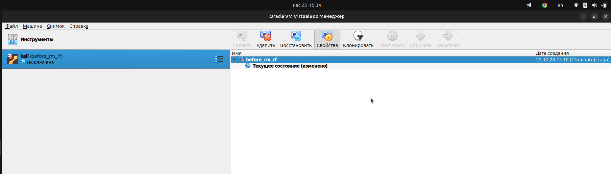
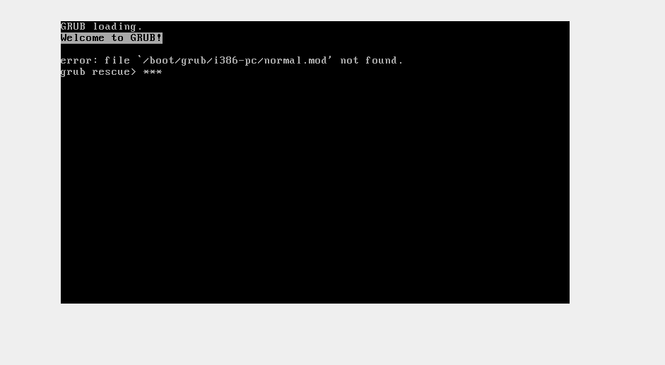
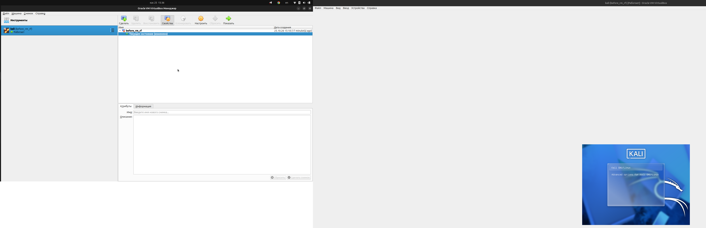

## 1. deleted git

```
┌──(aden-skirata㉿kali)-[~]
└─$ git --version     
git version 2.53.0
                                                                                                                                                                                                              
┌──(aden-skirata㉿kali)-[~]
└─$ sudo apt purge git
The following packages were automatically installed and are no longer required:
  binutils-mingw-w64-base    gcc-mingw-w64-i686-win32            libaio1t64          libntfs-3g89t64        libvidstab1.1          openssh-client-gssapi       python3-jaraco.functools  ruby-json
  binutils-mingw-w64-i686    gcc-mingw-w64-i686-win32-runtime    libavfilter11       libopenjph0.27         libx265-215            oracle-instantclient-basic  python3-more-itertools
  binutils-mingw-w64-x86-64  gcc-mingw-w64-x86-64-win32          libbluray3          libperl5.40            mingw-w64-common       perl-modules-5.40           python3-pkg-resources
  firmware-marvell-prestera  gcc-mingw-w64-x86-64-win32-runtime  libconfig++11       libpoppler156          mingw-w64-i686-dev     postgresql                  python3-typeguard
  g++-15                     git-man                             liberror-perl       libpython3.13-minimal  mingw-w64-x86-64-dev   python3-autocommand         python3.13
  g++-15-x86-64-linux-gnu    iucode-tool                         libimath-3-1-29t64  libpython3.13-stdlib   nasm                   python3-inflect             python3.13-minimal
  gcc-mingw-w64-base         libabsl20260107                     libjim0.83          libstdc++-15-dev       network-manager-gnome  python3-jaraco.context      rpcsvc-proto
Use 'sudo apt autoremove' to remove them.

REMOVING:
  git*  kali-tools-top10*  metasploit-framework*

Summary:
  Upgrading: 0, Installing: 0, Removing: 3, Not Upgrading: 3
  Freed space: 680 MB

Continue? [Y/n] y
(Reading database… 247993 files and directories currently installed.)
Removing kali-tools-top10 (2026.3.9)…
Removing metasploit-framework (6.5.3-0kali1)…
Removing git (1:2.53.0-1)…
Processing triggers for libc-bin (2.43-6)…
Processing triggers for man-db (2.13.1-1)…
Processing triggers for kali-menu (2026.3.4)…
(Reading database… 213131 files and directories currently installed.)
Purging configuration files for git (1:2.53.0-1)…
                                                                                                                                                                                                                
┌──(aden-skirata㉿kali)-[~]
└─$ git --version     
Command 'git' not found, but can be installed with:
sudo apt install git

Do you want to install it? (N/y)y
sudo apt install git
The following packages were automatically installed and are no longer required:
  binutils-mingw-w64-base    gcc-mingw-w64-base                  libabsl20260107     libjim0.83             libpython3.13-stdlib  mingw-w64-x86-64-dev        postgresql                python3-pkg-resources
  binutils-mingw-w64-i686    gcc-mingw-w64-i686-win32            libaio1t64          libntfs-3g89t64        libstdc++-15-dev      nasm                        python3-autocommand       python3-typeguard
  binutils-mingw-w64-x86-64  gcc-mingw-w64-i686-win32-runtime    libavfilter11       libopenjph0.27         libvidstab1.1         network-manager-gnome       python3-inflect           python3.13
  firmware-marvell-prestera  gcc-mingw-w64-x86-64-win32          libbluray3          libperl5.40            libx265-215           openssh-client-gssapi       python3-jaraco.context    python3.13-minimal
  g++-15                     gcc-mingw-w64-x86-64-win32-runtime  libconfig++11       libpoppler156          mingw-w64-common      oracle-instantclient-basic  python3-jaraco.functools  rpcsvc-proto
  g++-15-x86-64-linux-gnu    iucode-tool                         libimath-3-1-29t64  libpython3.13-minimal  mingw-w64-i686-dev    perl-modules-5.40           python3-more-itertools    ruby-json
Use 'sudo apt autoremove' to remove them.

Installing:
  git
                                                                                                                                                                                                                
Suggested packages:
  git-doc  git-email  git-gui  gitk  gitweb  git-cvs  git-svn

Summary:
  Upgrading: 0, Installing: 1, Removing: 0, Not Upgrading: 3
  Download size: 9,410 kB
  Space needed: 52.2 MB / 33.8 GB available

Get:1 http://kali.download/kali kali-rolling/main amd64 git amd64 1:2.53.0-1 [9,410 kB]
Fetched 9,410 kB in 1s (11.2 MB/s)
Selecting previously unselected package git.
(Reading database… 213130 files and directories currently installed.)
Preparing to unpack …/git_1%3a2.53.0-1_amd64.deb…
Unpacking git (1:2.53.0-1)…
Setting up git (1:2.53.0-1)…
Processing triggers for kali-menu (2026.3.4)…
                                                                                                                                                                                                                
┌──(aden-skirata㉿kali)-[~]
└─$ git --version
git version 2.53.0
```

## 2. Commands

### 1.touch

```
┌──(aden-skirata㉿kali)-[~]
└─$ touch file1.txt file2.txt
                                                                             
┌──(aden-skirata㉿kali)-[~]
└─$ ls
Desktop    Downloads  file2.txt  Pictures  Public     Videos
Documents  file1.txt  Music      Projects  Templates
                                                                             
┌──(aden-skirata㉿kali)-[~]
└─$ stat file1.txt
  File: file1.txt
  Size: 0               Blocks: 0          IO Block: 4096   regular empty file
Device: 8,1     Inode: 2356155     Links: 1
Access: (0664/-rw-rw-r--)  Uid: ( 1000/aden-skirata)   Gid: ( 1000/aden-skirata)
Access: 2026-10-25 06:52:46.478385466 -0400
Modify: 2026-10-25 06:52:46.478385466 -0400
Change: 2026-10-25 06:52:46.478385466 -0400
 Birth: 2026-10-25 06:52:46.478385466 -0400
                                                                             
┌──(aden-skirata㉿kali)-[~]
└─$ touch -a file1.txt
                                                                                                                                                                                                                                           
┌──(aden-skirata㉿kali)-[~]
└─$ stat file1.txt    
  File: file1.txt
  Size: 0               Blocks: 0          IO Block: 4096   regular empty file
Device: 8,1     Inode: 2356155     Links: 1
Access: (0664/-rw-rw-r--)  Uid: ( 1000/aden-skirata)   Gid: ( 1000/aden-skirata)
Access: 2026-10-25 07:00:14.909103530 -0400
Modify: 2026-10-25 06:54:30.241195927 -0400
Change: 2026-10-25 07:00:14.909103530 -0400
 Birth: 2026-10-25 06:52:46.478385466 -0400

```

### 2. nano

```
┌──(aden-skirata㉿kali)-[~]
└─$ nano -l file2.txt

  GNU nano 9.2                                                                                                     file2.txt                                                                                                               
 1 lorem ipsum 4
 2 lorem ipsum 5
 3 lorem ipsum 6
 4
```

### 3. cat

```
┌──(aden-skirata㉿kali)-[~]
└─$ cat file1.txt file2.txt 
lorem ipsum 1
lorem ipsum 2
lorem ipsum 3

lorem ipsum 4
lorem ipsum 5
lorem ipsum 6

┌──(aden-skirata㉿kali)-[~]
└─$ cat -n file1.txt file2.txt > combined_file.txt
                                                                                                                                                                                                                                           
┌──(aden-skirata㉿kali)-[~]
└─$ cat combined_file.txt 
     1  lorem ipsum 1
     2  lorem ipsum 2
     3  lorem ipsum 3
     4
     5  lorem ipsum 4
     6  lorem ipsum 5
     7  lorem ipsum 6 
```

### 4. pwd

```
┌──(aden-skirata㉿kali)-[~]
└─$ pwd -L
/home/aden-skirata
                   
```

### 5. ls

```
┌──(aden-skirata㉿kali)-[~]
└─$ ls -lsF
total 48
4 -rw-rw-r-- 1 aden-skirata aden-skirata  134 Oct 25 07:13 combined_file.txt
4 drwxr-xr-x 2 aden-skirata aden-skirata 4096 Oct 12 12:44 Desktop/
4 drwxr-xr-x 2 aden-skirata aden-skirata 4096 Oct 12 12:44 Documents/
4 drwxr-xr-x 2 aden-skirata aden-skirata 4096 Oct 12 12:44 Downloads/
4 -rw-rw-r-- 1 aden-skirata aden-skirata   43 Oct 25 07:07 file1.txt
4 -rw-rw-r-- 1 aden-skirata aden-skirata   42 Oct 25 07:09 file2.txt
4 drwxr-xr-x 2 aden-skirata aden-skirata 4096 Oct 12 12:44 Music/
4 drwxr-xr-x 2 aden-skirata aden-skirata 4096 Oct 14 12:16 Pictures/
4 drwxr-xr-x 2 aden-skirata aden-skirata 4096 Oct 12 12:44 Projects/
4 drwxr-xr-x 2 aden-skirata aden-skirata 4096 Oct 12 12:44 Public/
4 drwxr-xr-x 2 aden-skirata aden-skirata 4096 Oct 12 12:44 Templates/
4 drwxr-xr-x 2 aden-skirata aden-skirata 4096 Oct 12 12:44 Videos/
```

### 6. head

```
┌──(aden-skirata㉿kali)-[~]
└─$ head -c 100 /var/log/dpkg.log
2026-10-12 16:27:46 startup archives install
2026-10-12 16:27:46 install base-passwd:amd64 <none> 3.
```

### 7. tail

```
┌──(aden-skirata㉿kali)-[~]
└─$ tail -f ~/my_logs.txt 
Oct 25 07:38:34 kali kernel: 11:38:34.662592 dndHGCM   DnD: Received message HOST_DND_FN_GH_REQ_PENDING (0x258) from host
Oct 25 07:38:34 kali kernel: 11:38:34.663639 dnd       No guest source window
Oct 25 07:38:34 kali kernel: 11:38:34.675111 dndHGCM   DnD: Received message HOST_DND_FN_GH_REQ_PENDING (0x258) from host
Oct 25 07:38:34 kali kernel: 11:38:34.679895 dnd       No guest source window
Oct 25 07:38:34 kali kernel: 11:38:34.681781 dndHGCM   DnD: Received message HOST_DND_FN_GH_REQ_PENDING (0x258) from host
Oct 25 07:38:34 kali kernel: 11:38:34.683433 dnd       No guest source window
Oct 25 07:38:34 kali kernel: 11:38:34.694571 dndHGCM   DnD: Received message HOST_DND_FN_GH_REQ_PENDING (0x258) from host
Oct 25 07:38:34 kali kernel: 11:38:34.695575 dnd       No guest source window
Oct 25 07:38:34 kali kernel: 11:38:34.702638 dndHGCM   DnD: Received message HOST_DND_FN_GH_REQ_PENDING (0x258) from host
Oct 25 07:38:34 kali kernel: 11:38:34.703471 dnd       No guest source window
```

### 8. less

```
┌──(aden-skirata㉿kali)-[~]
└─$ less -N file1.txt

      1 lorem ipsum 1
      2 lorem ipsum 2
      3 lorem ipsum 3
      4 
file1.txt (END)
```

### 9. tree

```
┌──(aden-skirata㉿kali)-[~]
└─$ tree -apL 2
[drwx------]  .
├── [-rw-r--r--]  .bash_logout
├── [-rw-r--r--]  .bashrc
├── [-rw-r--r--]  .bashrc.original
├── [drwxrwxr-x]  .cache
│   ├── [drwxr-xr-x]  fontconfig
│   ├── [drwxrwxr-x]  glycin
│   ├── [drwxrwxr-x]  gstreamer-1.0
│   ├── [drwx------]  mesa_shader_cache
│   ├── [drwx------]  obexd
│   ├── [drwx------]  sessions
│   ├── [drwx------]  thumbnails
│   ├── [drwxrwxr-x]  xfce4
│   └── [-rw-rw-r--]  zcompdump
├── [-rw-rw-r--]  combined_file.txt
├── [drwxr-xr-x]  .config
│   ├── [drwxr-xr-x]  autostart
```

### 10. mkdir

```
┌──(aden-skirata㉿kali)-[~]
└─$ mkdir -m 777 new_dir_exemp
┌──(aden-skirata㉿kali)-[~]
└─$ ls -ld new_dir_exemp
drwxrwxrwx 2 aden-skirata aden-skirata 4096 Oct 25 07:56 new_dir_exemp
```

### 11. rm

```
┌──(aden-skirata㉿kali)-[~]
└─$ rm -v file1.txt 
removed 'file1.txt'
```

### 12. rmdir

```
┌──(aden-skirata㉿kali)-[~]
└─$ rmdir -p new_dir_exemp 
                                                                                                                                                                                                                                           
┌──(aden-skirata㉿kali)-[~]
└─$ pwd
/home/aden-skirata
```


## 3. delete / and restore system from snapshot

```
┌──(aden-skirata㉿kali)-[~]
└─$ sudo rm -rf /*
                                                                                                                                                                                       >
error: file '/boot/grub/i386-pc/normal.mod' not found.
```

### До удаления


### После удаления


### После восстановления


## 4. sudo without password

```
┌──(aden-skirata㉿kali)-[~]
└─$ echo "aden-skirata ALL=(ALL:ALL) NOPASSWD:ALL" | sudo tee /etc/sudoers.d/aden-skirata
[sudo] password for aden-skirata: 
aden-skirata ALL=(ALL:ALL) NOPASSWD:ALL

┌──(aden-skirata㉿kali)-[~]
└─$ sudo whoami   
root
                                                                                                                                                                                                                                          
┌──(aden-skirata㉿kali)-[~]
└─$ sudo cat /etc/sudoers.d/aden-skirata
aden-skirata ALL=(ALL:ALL) NOPASSWD:ALL
```

## 5. daemon (root usage, free space, inode usage, systemd failed units count)

```
┌──(aden-skirata㉿kali)-[~]
└─$ sudo nano /usr/local/bin/system-monitor.sh
                                                                                                                                                                                                                                         
┌──(aden-skirata㉿kali)-[~]
└─$ sudo nano /usr/local/bin/storage-monitor.sh
                                                                                                                                                                                                                                         
┌──(aden-skirata㉿kali)-[~]
└─$ sudo chmod +x /usr/local/bin/storage-monitor.sh
                                                                                                                                                                                                                                         
┌──(aden-skirata㉿kali)-[~]
└─$ ls -ld /usr/local/bin/storage-monitor.sh

-rwxr-xr-x 1 root root 496 Oct 25 09:32 /usr/local/bin/storage-monitor.sh
                                                                                                                                                                                                                                         
┌──(aden-skirata㉿kali)-[~]
└─$ sudo nano /etc/systemd/system/storage-monitor.service
                                                                                                                                                                                                                                         
┌──(aden-skirata㉿kali)-[~]
└─$ sudo nano /etc/systemd/system/storage-monitor.timer
                                                                                                                                                                                                                                         
┌──(aden-skirata㉿kali)-[~]
└─$ sudo systemctl daemon-reload
                                                                                                                                                                                                                                         
┌──(aden-skirata㉿kali)-[~]
└─$ sudo systemctl enable --now storage-monitor.timer
Created symlink '/etc/systemd/system/timers.target.wants/storage-monitor.timer' → '/etc/systemd/system/storage-monitor.timer'.
                                                                                                                                                                                                                                         
┌──(aden-skirata㉿kali)-[~]
└─$ systemctl list-timers storage-monitor.timer
NEXT                        LEFT LAST PASSED UNIT                  ACTIVATES              
Sun 2026-10-25 09:45:00 EDT 7min -         - storage-monitor.timer storage-monitor.service

1 timers listed.
Pass --all to see loaded but inactive timers, too.
                                                                                                                                                                                                                                         
┌──(aden-skirata㉿kali)-[~]
└─$ sudo systemctl start storage-monitor.service
                                                                                                                                                                                                                                         
┌──(aden-skirata㉿kali)-[~]
└─$ cat /var/log/storage-monitor.log
timestamp=2026-10-25 09:38:07 root_usage_percent=23 root_avail=31G inode_usage_percent=10 failed_units=0

```

### storage-monitor.sh

```
#!/bin/bash
LOG_FILE="/var/log/storage-monitor.log"
TIMESTAMP=$(date +"%Y-%m-%d %H:%M:%S")
ROOT_USAGE=$(df -P / | awk 'NR==2 {gsub("%","",$5); print $5}')
ROOT_AVAIL=$(df -P -h / | awk 'NR==2 {print $4}')
INODE_USAGE=$(df -P -i / | awk 'NR==2 {gsub("%","",$5); print $5}')
FAILED_UNITS=$(systemctl --failed --no-legend --no-pager | wc -l)
echo "timestamp=$TIMESTAMP root_usage_percent=$ROOT_USAGE root_avail=$ROOT_AVAIL inode_usage_percent=$INODE_USAGE failed_units=$FAILED_UNITS" >> "$LOG_FILE"
```

### storage-monitor.service

```
[Unit]
Description=Storage Monitor

[Service]
Type=oneshot
ExecStart=/usr/local/bin/storage-monitor.sh
```

### storage-monitor.timer

```
[Unit]
Description=Run Storage Monitor every 15 minutes

[Timer]
OnCalendar=*:0/15
Persistent=true

[Install]
WantedBy=timers.target
```
